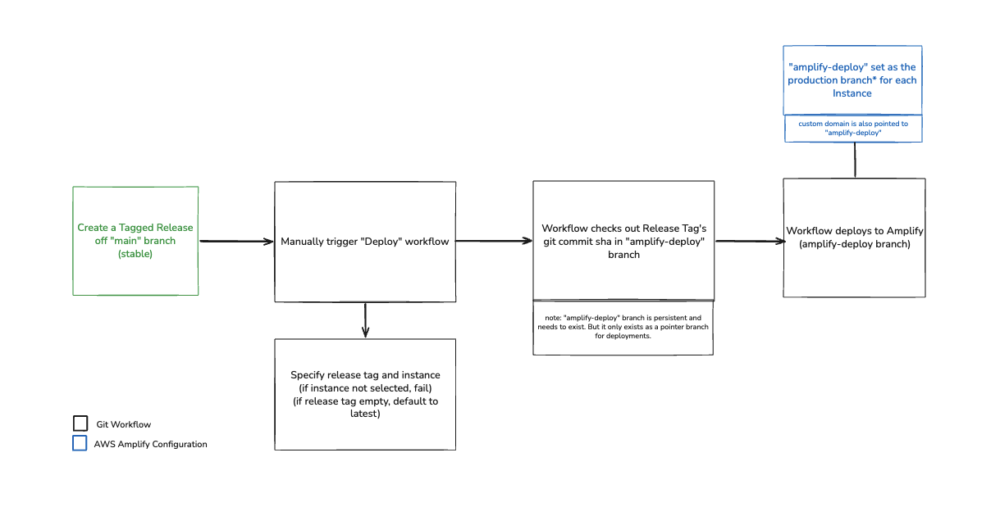

# Deployment Guides

Use these guides when standing up a **new** ingest-ui instance.

- [Amplify New Instance Runbook](./amplify-new-instance-runbook.md)
- [GitHub App Setup for Destination Repos](./github-app-setup.md)

## Current Deployment Model

For existing instances, deployments are triggered manually by running the [Deploy workflow](../../.github/workflows/deploy.yml) in github actions.

### Workflow

### Amplify App Instances Configuration
* `amplify-deploy` is set as...
   * The production branch for each app instance
   * For our custom domains (i.e. url: `https://ingest.openveda.cloud`)
   * `Auto-build` is `disabled`

### Instructions
1. Navigate to github actions in the repository, and select the `Deploy` workflow
2. Click `Run workflow`

   2a. Specify a release tag (optional, it will default to latest stable if nothing is specified)
   
   2b. Check off which instance you'd like to deploy to (required, will fail if nothing selected)
3. If successful, the amplify console would also display the commit it was released with (i.e. `Release x.x.x`)

### Requirements
For the `Deploy` dispatch workflow to run successfuly, these are required:
* In Github:
   * An `amplify-deploy` branch that persists and just lives as a pointer branch (for force-pushing to the release tag git commit sha) for production deployments
   * These repository variables must exist:
      * `AWS_DEPLOY_ROLE_ARN`: Uses the `GitHubActionsAmplifyPreviewRole` arn as it has the appropriate permissions
      * `AMPLIFY_INSTANCE_APP_IDS`: Must include the instance name and app id in the variable value for the github actions matrix strategy
* In AWS Amplify for each instance:
   * See [Amplify App Instances Configuration](#amplify-app-instances-configuration)

## Rollbacks
For a Rollback, just specify a release tag you'd like to rollback to and dispatch the workflow.

## Which Guide Should I Start With?

1. Start with the Amplify runbook for end-to-end setup.
2. Use the GitHub App guide for selecting or creating the app and filling `APP_ID`, `INSTALLATION_ID`, and `GITHUB_PRIVATE_KEY`.

## Related Documentation

For thumbnail upload role, IAM permissions, and upload/preview flow details, see [Thumbnail Upload](../thumbnail-upload.md).
